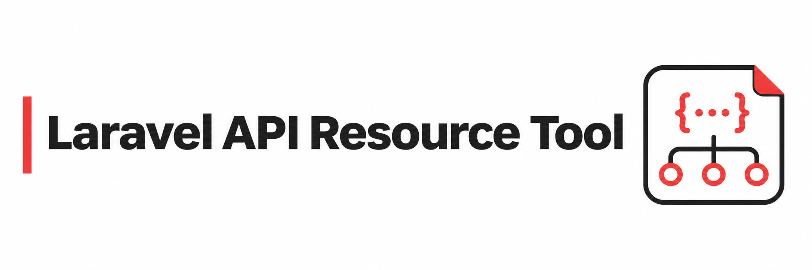

# Laravel API Resource Tool

<div align="center">



[](https://packagist.org/packages/evanschleret/laravel-api-resource-tool)
[](https://github.com/EvanSchleret/laravel-api-resource-tool/actions/workflows/tests.yml)
[](https://packagist.org/packages/evanschleret/laravel-api-resource-tool)
[](https://packagist.org/packages/evanschleret/laravel-api-resource-tool)
[](README.md#requirements)
[](https://packagist.org/packages/evanschleret/laravel-api-resource-tool)

</div>

Reusable JSON resource responses and request-driven Eloquent scopes for Laravel.

## Requirements

- PHP 8.2 or later (Laravel 13 requires PHP 8.3 or later)
- Laravel 13
- Laravel 12 (deprecated; compatibility ends February 24, 2027)

Laravel Scout is optional and is needed only when paginating Scout builders.

## Installation

```bash
composer require evanschleret/laravel-api-resource-tool
```

## Resource responses

Call the class directly:

```php
use EvanSchleret\LaravelApiResourceTool\ResourceTool;

return ResourceTool::paginate($request, new PostResource($post), Post::query());
```

Or use the trait in a controller:

```php
use EvanSchleret\LaravelApiResourceTool\Concerns\ResourceToolTrait;

class PostController
{
    use ResourceToolTrait;

    public function index(Request $request)
    {
        return self::paginate($request, new PostResource(new Post), Post::query());
    }
}
```

The available methods are `paginate`, `cursorPaginate`, `collection`, `make`, `created`, `content`, `accepted`, `noContent`, `successResponse`, and `errorResponse`.

Publish the package configuration to change the default page size, which is 21:

```bash
php artisan vendor:publish --tag=laravel-api-resource-tool-config
```

The configured `pagination.default_per_page` value is used by `paginate()` and `cursorPaginate()` when their limit argument is omitted. An explicit limit passed to either method takes precedence.

`paginate()` also reads a positive integer `perPage` query parameter when no explicit limit is passed. For example, the following request asks for 50 results:

```text
GET /posts?perPage=50
```

When `perPage` is absent or invalid, `paginate()` uses `pagination.default_per_page`. Both pagination methods cap the selected limit at `pagination.max_per_page`, which defaults to 100. The maximum also applies to explicit limits. `cursorPaginate()` does not read the `perPage` query parameter.

Set both pagination values in the published package configuration:

```php
'pagination' => [
    'default_per_page' => 21,
    'max_per_page' => 100,
],
```

## Response format

Successful responses use the same envelope. A single resource or a collection returns its contents in `data`:

```json
{
  "status": "success",
  "message": "",
  "data": {"id": 42, "title": "Example"}
}
```

Paginated responses put pagination links and metadata beside `data`:

```json
{
  "status": "success",
  "message": "",
  "data": [{"id": 42, "title": "Example"}],
  "links": {"first": "...", "last": "...", "prev": null, "next": "..."},
  "meta": {"current_page": 1, "last_page": 5, "per_page": 21, "total": 105}
}
```

Error responses keep the same core keys and use the HTTP response status code:

```json
{
  "status": "error",
  "message": "Not found",
  "data": null,
  "code": "NOT_FOUND"
}
```

`errorResponse()` also accepts an optional field-to-messages `errors` array:

```php
return ResourceTool::errorResponse(
    message: 'The given data was invalid.',
    statusCode: 422,
    code: 'VALIDATION_ERROR',
    errors: $validator->errors()->toArray(),
);
```

To use the package envelope for Laravel's JSON validation responses globally, publish the configuration and enable the option:

```php
'responses' => [
    'validation_errors' => true,
],
```

With this option enabled, Laravel `ValidationException` responses for requests expecting JSON use the package's error envelope and include field errors automatically. The option is disabled by default. HTML validation redirects and other Laravel exceptions keep Laravel's default behavior.

`created()` returns a resource with HTTP 201. `accepted()` returns the standard success envelope with HTTP 202. `noContent()` returns an empty HTTP 204 response without a JSON body.

`collection()` accepts an Eloquent builder, a relation, or a collection. `paginate()` accepts a pageable Eloquent builder, relation, or Laravel Scout builder. `Collection` is not accepted by `paginate()` because it does not provide query pagination.

Cursor pagination is available for Eloquent builders and relations. The query must have a stable order with a unique, non-null column or combination of columns. Cursor pagination returns next and previous links but does not provide numbered pages or a total count:

```php
return ResourceTool::cursorPaginate(
    $request,
    new PostResource(new Post),
    Post::query()->orderBy('id'),
);
```

This response format places collection data directly in `data`, removes the `ok` and `success` flags, and no longer repeats the HTTP status in a `statusCode` body field.

## Model scopes

Add `HasFilterOptions` to a model, then opt into request-driven scopes on each query:

```php
use EvanSchleret\LaravelApiResourceTool\Concerns\HasFilterOptions;
use Illuminate\Database\Eloquent\Model;

class Post extends Model
{
    use HasFilterOptions;
}
```

Use `filterOptions()` to combine the scopes, or call `filter()` and `search()` separately:

```php
$posts = Post::query()
    ->filterOptions([
        'filter' => true,
        'authorized_filters' => ['status', 'author.name', 'comments.length'],
        'search_columns' => ['title', 'author.name'],
        'sortable_columns' => ['title', 'created_at'],
    ])
    ->paginate();
```

`filter()` accepts the authorized filter list directly. `search()` accepts the searchable column list. The scopes read `filter`, `defaultFilter`, `search`, `sort`, `orderBy`, and `desc` from the current request.

Filters are ignored unless their key is authorized. Add `trashed` to the authorized list to allow `trashed=true` to include soft-deleted records. Authorize relation counts explicitly, for example with a `comments.length` entry.

## Filter format

Pass `filter` as a JSON-encoded array in the request. `defaultFilter` uses the same format and is combined with the user filters.

```json
[
  {"key": "status", "operator": "=", "value": "published"},
  {"key": "author.name", "operator": "like", "value": "Ada%"},
  {"key": "id", "operator": "in", "value": [2, 5, 8]}
]
```

The supported operators are `=`, `==`, `===`, `!=`, `!==`, `<>`, `<`, `<=`, `>`, `>=`, `like`, `not like`, `in`, and `not in`. Equality and inequality with a `null` value become `IS NULL` and `IS NOT NULL`. The `in` operators require an array value. Unsupported operators, malformed filters, and unauthorized keys are ignored.

Authorize nested relation fields and relation counts explicitly:

```php
'authorized_filters' => [
    'status',
    'author.name',
    'comments.length' => ['approved'],
],
```

A numeric `comments.length` value filters the number of related comments. An object value filters the related rows before counting them:

```json
{"key": "comments.length", "operator": ">=", "value": {"column": "approved", "operator": "=", "value": true}}
```

For JSON attributes, authorize the full attribute path, such as `metadata.theme`. Search uses substring matching on the configured `search_columns`.

Sorting accepts multiple comma-separated columns through `sort`. Prefix a column with `-` for descending order; unprefixed columns sort ascending:

```text
?sort=-created_at,title
```

Set `sortable_columns` in `filterOptions()` or use the `sort()` scope to restrict sorting to an explicit list. Columns outside that list are ignored. Without a list, sorting remains limited to real columns on the model's table, preserving the previous behavior. The legacy `orderBy` and `desc` parameters continue to work when `sort` is not provided.

```php
$posts = Post::query()
    ->filter(['status'])
    ->sort(['created_at', 'title'])
    ->get();
```

## Project status

Laravel 13 is actively supported. Laravel 12 compatibility is deprecated and will end on February 24, 2027. Laravel versions below 12 are not supported.

## Contributing

See the [contribution guide](https://github.com/EvanSchleret/laravel-api-resource-tool/blob/main/CONTRIBUTING.md) and [code of conduct](https://github.com/EvanSchleret/laravel-api-resource-tool/blob/main/CODE_OF_CONDUCT.md). Questions and proposals can be raised in the [GitHub issue tracker](https://github.com/EvanSchleret/laravel-api-resource-tool/issues).

## Security

Please report vulnerabilities privately using [GitHub's security advisory form](https://github.com/EvanSchleret/laravel-api-resource-tool/security/advisories/new). See the [security policy](https://github.com/EvanSchleret/laravel-api-resource-tool/blob/main/SECURITY.md).

## License

MIT. See the [license](https://github.com/EvanSchleret/laravel-api-resource-tool/blob/main/LICENSE).
